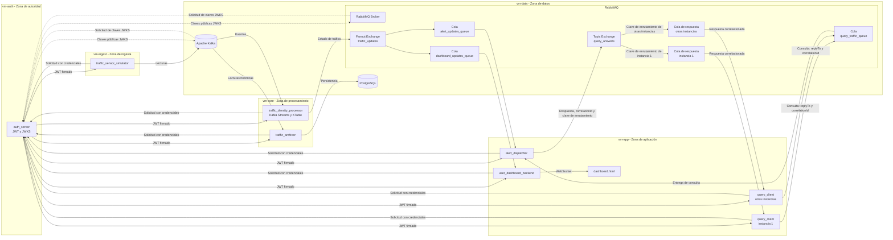

# SmartTraffic - Zona Cero (Zero Trust)

Proyecto final del ejercicio 12 para las asignaturas de Sistemas Distribuidos, Sistemas Operativos y Programación Orientada a Objetos. SmartTraffic propone una arquitectura distribuida para simular lecturas de sensores de tráfico, calcular el nivel de congestión por zona, distribuir actualizaciones y alertas, responder consultas y conservar un histórico.

> **Estado verificado al 17 de noviembre de 2026:** la demo está desplegada en AWS y se comprobó el dashboard desde un portátil mediante un túnel SSM. En la misma sesión, los dos `query-client` recibieron respuestas para dos zonas, `alert-dispatcher` registró transiciones de estado y PostgreSQL mostró 39.930 lecturas, incluidas 597 en los diez minutos previos a la consulta. La última lectura observada fue `2026-11-17 14:22:43 UTC`; estos valores son una captura de esa validación, no métricas permanentes.
>
> Una inspección AWS de solo lectura confirmó una diferencia importante: cinco subnets están asociadas a la tabla `smarttraffic-private`, cuya ruta `0.0.0.0/0` va a un NAT Gateway público disponible; la subnet `smarttraffic-nat` tiene ruta a un Internet Gateway. Terraform describe otra topología (subnets de VM con ruta directa al Internet Gateway y sin NAT). No apliques Terraform hasta reconciliar el estado y el plan con AWS, proteger los datos y revisar los costos.
>
> La ejecución raíz de `mvn -B test` terminó con `BUILD SUCCESS`, cero fallos y cero errores; cinco casos que requieren servicios externos se omitieron en esa ejecución. La integración PostgreSQL de V1/V2 pasó por separado con dos casos en un contenedor local desechable; eso no valida AWS. Terraform no está reconciliado con el despliegue. En la consola, los IDs, CIDR y AZ de las cinco subnets de VM y la subnet NAT, las dos tablas de rutas, la ruta predeterminada al NAT y las asociaciones coinciden con el state local; esto solo verifica la parte de red. Un plan completo contra AWS, usando `terraform.tfvars.example`, terminó con **0 altas, 0 cambios y 68 destrucciones**: el ejemplo desactiva la creación mientras el state contiene recursos. El HCL también describe una red distinta. No se ejecutó `apply`; **no apliques Terraform** hasta reconciliar configuración, state, datos y costos. La revisión AWS confirmó cinco volúmenes raíz EBS cifrados de 30 GiB; en `vm-data`, `vm-core`, `vm-ingest` y `vm-auth` solo se observaron discos raíz XFS, sin los volúmenes de datos separados previstos para PostgreSQL, Kafka y RabbitMQ. En las cinco VM, `nftables` aplica `drop` por defecto y permite TCP 443 a destinos fuera del CIDR de la VPC. En `vm-data`, Kafka negoció TLS 1.3 pero OpenSSL no confió en la CA autofirmada; RabbitMQ confirmó `amqp/ssl` y PostgreSQL devolvió `ssl=off`. En `vm-auth`, TLS 1.3 también negoció con esa CA. Los truststores de los tres clientes Kafka inspeccionados son legibles y coinciden por huella con la CA presentada por Kafka y Auth Server; los logs recientes muestran publicaciones confirmadas por el simulador. Las CA PEM de RabbitMQ en el procesador y los cuatro clientes de `vm-app` también coinciden por huella con la raíz servida, aunque consultar el certificado no prueba conexiones AMQPS efectivas. Falta identificar el commit y confirmar por separado operaciones exitosas de los clientes de `vm-core` y `vm-app`. En `vm-app`, el listener `127.0.0.1:8080` responde HTTP; HTTPS/TLS falla con `wrong version number`. Las imágenes de los contenedores de `vm-app` no informan un `org.opencontainers.image.revision`, así que no identifican el commit desplegado. No presentes la infraestructura como reproducible desde cero hasta reconciliar Terraform y decidir el tratamiento de datos.

## Contexto y problema

Una ciudad inteligente necesita recibir lecturas de tráfico de varios sensores, procesarlas continuamente y compartir el estado de cada zona con aplicaciones y servicios de alerta. SmartTraffic plantea ese flujo con mensajería distribuida, persistencia histórica y controles de seguridad entre servicios.

El proyecto despliega sus componentes en cinco zonas de seguridad, usando contenedores Docker y reglas de red de denegación por defecto en lugar de una única red plana.

## Objetivos

### Objetivo general

Diseñar e implementar progresivamente un sistema distribuido de monitoreo de tráfico que integre Kafka, Kafka Streams, RabbitMQ y PostgreSQL, con servicios Java orientados a objetos y una infraestructura segmentada con controles Zero Trust.

### Objetivos específicos

- Simular lecturas aleatorias de sensores y procesarlas mediante Kafka.
- Mantener el estado de tráfico por zona con Kafka Streams y una KTable.
- Distribuir actualizaciones y atender consultas asíncronas mediante RabbitMQ.
- Persistir lecturas y registros de auditoría en PostgreSQL.
- Aplicar autenticación de servicio a servicio mediante JWT y configurar autorización en los brokers.
- Desplegar los componentes en cinco VMs con redes y recursos delimitados.
- Aplicar patrones de diseño, principios SOLID y pruebas automatizadas en Java.

## Asignaturas integradas

- **Sistemas Distribuidos:** Kafka, Kafka Streams, RabbitMQ, microservicios, comunicación asíncrona y concurrencia.
- **Sistemas Operativos:** máquinas virtuales, Linux, Docker, aislamiento, reglas `nftables` y límites de recursos.
- **Programación Orientada a Objetos:** Java, Spring Boot, SOLID, patrones de diseño, persistencia y pruebas.

## Arquitectura desplegada

El despliegue se divide en cinco zonas. La configuración por VM está en `infra/vm-*/compose.yaml` y el dashboard se presentó por un túnel SSM, sin publicar su puerto al Internet. La tabla describe la distribución configurada; las IP, credenciales y certificados concretos se mantienen fuera del repositorio.

| Zona | Componentes | Responsabilidad |
|---|---|---|
| `vm-auth` | `auth_server` | Emitir tokens JWT y publicar claves públicas mediante JWKS. |
| `vm-data` | Kafka, RabbitMQ, PostgreSQL | Proveer mensajería y almacenamiento a los servicios autorizados. |
| `vm-ingest` | `traffic_sensor_simulator` | Generar lecturas aleatorias y publicarlas en Kafka. |
| `vm-core` | `traffic_density_processor`, `traffic_archiver` | Calcular el estado por zona, distribuirlo y persistir lecturas. |
| `vm-app` | `user_dashboard_backend`, `alert_dispatcher`, `query_client`, `dashboard.html` | Exponer el dashboard, generar alertas y simular consultas. |

### Componentes de aplicación

El sistema contempla siete microservicios y una interfaz web:

| Componente | Responsabilidad |
|---|---|
| `auth_server` | Autenticar clientes de servicio y emitir tokens JWT. |
| `traffic_sensor_simulator` | Generar lecturas aleatorias de sensores y enviarlas a Kafka. |
| `traffic_density_processor` | Procesar eventos con Kafka Streams, mantener estado por zona y publicar actualizaciones en RabbitMQ. |
| `traffic_archiver` | Consumir lecturas y almacenarlas como histórico en PostgreSQL. |
| `user_dashboard_backend` | Consumir actualizaciones de tráfico y servirlas al dashboard mediante WebSocket. |
| `alert_dispatcher` | Mantener una réplica local, registrar cada transición de estado como alerta y responder consultas desde esa réplica. |
| `query_client` | Enviar consultas periódicas por zona y recibir respuestas asíncronas con correlación por solicitud e instancia. |
| `dashboard.html` | Interfaz web que presenta el estado recibido por el backend del dashboard. |

### Recorrido de los mensajes

1. `traffic_sensor_simulator` genera lecturas y las publica en un tópico de Kafka.
2. `traffic_density_processor` consume esas lecturas mediante Kafka Streams, las agrupa por zona y mantiene agregados en ventanas; el estado publicado se conserva en stores de Kafka Streams.
3. El procesador publica estados consolidados en el fanout exchange `traffic_updates` de RabbitMQ. El despliegue configura colas independientes para el dashboard y el servicio de alertas, para que ambos reciban cada actualización.
4. `user_dashboard_backend` entrega las actualizaciones al cliente web. `alert_dispatcher` conserva la última actualización por zona, descarta marcas de tiempo antiguas y registra una alerta cuando cambia el estado, incluida la recuperación. Es una regla inicial de demostración, no una política de notificación aprobada.
5. `traffic_archiver` consume las lecturas originales y las persiste en PostgreSQL.
6. Cada instancia de `query_client` publica una consulta con zonas, `requestId`, `correlationId` y su cola en `replyTo`. `alert_dispatcher` responde desde su réplica local en el topic exchange `query_answers`, usando `instanceId` como clave de enrutamiento. El cliente valida la correlación y registra zonas sin estado disponible.

## Seguridad Zero Trust

El repositorio configura identidades de servicio, JWT firmados con RS256 y claves públicas mediante JWKS; los flujos funcionales de consulta, alertas y persistencia se observaron en AWS. Sin embargo, esa evidencia no demuestra que las políticas de autenticación y rechazo se hayan probado en AWS: las verificaciones de seguridad descritas abajo corresponden a código y fixtures locales.

- **Kafka:** el cliente usa SASL_SSL/OAUTHBEARER; el fixture local configura validación JWT y ACL. Las pruebas locales incluyen renovación aceptada y rechazada y, en una ejecución aislada del 18 de noviembre de 2026, rechazo de token ausente o malformado, `issuer`/audiencia incorrectos y un principal válido sin permiso `WRITE` en `traffic_readings`. Estas pruebas son locales; no validan los controles en AWS.
- **RabbitMQ:** el fixture local usa el plugin OAuth2 y comprueba rechazos por token ausente, expiración, audiencia y permisos insuficientes. Una prueba local aceptó un token firmado por una clave confiable con un `issuer` distinto; por ello, no se afirma que la validación de igualdad del `issuer` esté comprobada. No se encontró evidencia de estas pruebas en AWS.
- **TLS y red:** el fixture Kafka usa TLS para clientes y mTLS en el listener del controlador. RabbitMQ valida TLS para JWKS y los clientes validan el certificado AMQPS, pero RabbitMQ no exige certificado cliente. La plantilla de `nftables` define políticas `drop` por defecto; antes de afirmar que el egreso es estrictamente de mínimo privilegio, confirma la excepción HTTPS temporal en la configuración efectiva de Ansible.

Las credenciales, claves y archivos de configuración de despliegue no se incluyen en el repositorio. La matriz de red y los parámetros operativos deben revisarse con los responsables de infraestructura y autenticación antes de presentar la configuración como una validación formal completa de Zero Trust.

## Diseño orientado a objetos

La lógica de dominio aplica encapsulamiento e invariantes explícitas, dependencias inyectadas por constructor y abstracciones para brokers y persistencia.

- **Strategy:** intercambiar algoritmos de cálculo de densidad, como promedio simple y promedio ponderado en una ventana temporal.
- **State:** representar las transiciones entre `DESPEJADA`, `MODERADA` y `CONGESTIONADA`.
- **Observer:** notificar eventos internos cuando ocurran cambios o incrementos críticos de densidad.
- **SOLID y DIP:** separar dominio, aplicación e infraestructura, e invertir dependencias mediante interfaces.
- **Value Objects:** utilizar tipos inmutables, incluidos `record` de Java, con validación temprana de valores inválidos.

## Persistencia y pruebas

PostgreSQL almacena el histórico mediante Spring Data JPA / Hibernate. La migración local V2 agrega `traffic_reading_audit` para registrar cada inserción efectiva nueva y triggers que rechazan cambios, borrados y truncados del histórico y de la auditoría; las pruebas PostgreSQL comprueban también la idempotencia. No se hace backfill de lecturas existentes. Como el rol de aplicación sigue siendo propietario, un usuario privilegiado puede modificar o deshabilitar esos triggers: no se afirma inmutabilidad frente al dueño o administrador de la base. Esta migración local aún no se ha aplicado ni validado en AWS.

JUnit 5 y Mockito se utilizan para pruebas unitarias con Arrange, Act, Assert. Las pruebas de dominio se ejecutan en memoria; las pruebas de integración están separadas y algunas se omiten en la ejecución Maven normal porque requieren servicios externos.

## Contenedores e infraestructura

Docker Compose separa los servicios por VM y el Dockerfile compartido para aplicaciones Java usa etapas de compilación y ejecución, una imagen JRE y un usuario no privilegiado. `docker inspect` confirmó límites efectivos de CPU/memoria en los 11 contenedores; véase [infra/aws/README.md](infra/aws/README.md). Las muestras de `docker stats` son instantáneas y no una prueba de carga. `vm-app` define dos réplicas fijas de `query-client` como servicios independientes, cada una con su identidad y cola de respuesta; no se usa `deploy.replicas`, que no permite asignar identidades y colas distintas a cada instancia en este despliegue.

Ansible contiene el aprovisionamiento y despliegue por rol para las cinco VMs. Terraform permanece en revisión: no apliques cambios hasta reconciliar el plan con los recursos existentes y definir la recuperación/migración de los datos.

## Tecnologías utilizadas

Java 17 o superior, Spring Boot, Maven, Apache Kafka, Kafka Streams, RabbitMQ, PostgreSQL, Spring Data JPA / Hibernate, JWT, JWKS, OAuth2, SASL/OAUTHBEARER, TLS, Docker, Ansible, `nftables`, JUnit 5 y Mockito.

## Diagrama de arquitectura

El siguiente diagrama representa la arquitectura lógica del despliegue. Omite las direcciones, credenciales y certificados concretos:

## Equipo

- **Sebastián Rosero:** coordinación e integración, dominio Java, POO y persistencia.
- **Héctor:** infraestructura, Ansible, VMs, Docker y `nftables`.
- **Steven:** autenticación, JWT/JWKS y seguridad de Kafka y RabbitMQ.

Las responsabilidades son iniciales y no reemplazan la revisión cruzada: el equipo trabajará conjuntamente en las integraciones, pruebas y demostración.

## Estado de validación y pendientes de entrega

### Comprobado

- La demo del dashboard se abrió desde el portátil mediante SSM y mostró actualizaciones en vivo de dos zonas.
- Los dos clientes de consulta registraron respuestas para dos zonas; el dispatcher registró transiciones entre `DESPEJADA`, `MODERADA` y `CONGESTIONADA`.
- Una consulta de solo lectura a `traffic_readings` mostró 39.930 filas, 597 con `occurred_at` en los diez minutos previos y una última lectura de `2026-11-17 14:22:43 UTC`.
- El 17 de noviembre de 2026 se verificó desde el portátil el acceso al dashboard mediante un túnel SSM local; el backend indicó conexión y la marca de última medición avanzó mientras la página permanecía abierta. Esto valida esa sesión de presentación, no la reproducibilidad completa de AWS ni todos los controles de seguridad.
- `mvn -B test` ejecutado desde la raíz terminó con `BUILD SUCCESS`, cero fallos y cero errores. Se omitieron cinco casos que requieren servicios externos; consulta los README de los módulos para sus condiciones. La integración PostgreSQL con V1/V2 pasó por separado con dos casos en un contenedor local desechable.

### Pendiente antes de una entrega formal

1. Revisar la [matriz de red](docs/network-matrix.md) y las guías de despliegue actualizadas con la evidencia de la demo SSM; confirmar con los responsables los puertos, flujos y políticas efectivas que no se inspeccionaron.
2. Comparar el código con cada requisito del enunciado. Los siete microservicios usan Spring Boot (`auth-server`, archivador, backend del dashboard, simulador, procesador, `alert-dispatcher` y `query-client`). El código local incorpora auditoría de nuevas lecturas y bloqueos por trigger, sujetos al límite del rol propietario; `vm-app` define dos instancias fijas de `query-client` con identidades y colas distintas. La igualdad del `issuer` sigue sin estar garantizada por el backend OAuth2 estándar de RabbitMQ 4.3.7.
3. Decidir el alcance aprobado para la excepción de egreso HTTPS observada en las cinco VM.
4. Reconciliar Terraform con el estado AWS observado: cinco grupos de instancias, reglas por rol, cinco volúmenes raíz y ausencia de volúmenes separados en `vm-data`. Decidir, con respaldo y plan de recuperación, si se crean y migran los datos a los volúmenes EBS dedicados. No aplicar el plan mencionado en un reporte anterior sin validarlo contra el state y el estado AWS actuales.
5. Identificar el commit desplegado: las imágenes locales de `vm-app` no incluyen la etiqueta OCI `org.opencontainers.image.revision`. Revisar el cambio local de `.terraform.lock.hcl`, dejar el árbol de trabajo intencional y publicar en GitHub la versión que se presentará.
6. Ensayar una demostración de máximo 15 minutos desde el portátil, con el túnel SSM temporal, que explique decisiones de arquitectura, código y evidencia validada sin afirmar controles que aún no se hayan verificado.
