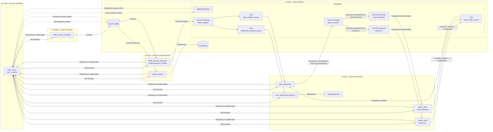

# SmartTraffic - Zona Cero (Zero Trust)

Proyecto final del ejercicio 12 para las asignaturas de Sistemas Distribuidos, Sistemas Operativos y Programación Orientada a Objetos. SmartTraffic propone una arquitectura distribuida para simular lecturas de sensores de tráfico, calcular el nivel de congestión por zona, distribuir actualizaciones y alertas, responder consultas y conservar un histórico.

> **Estado:** fase inicial de desarrollo. Este documento describe la arquitectura propuesta de acuerdo con el enunciado; los componentes y flujos descritos aún no se consideran implementados ni verificados.

## Contexto y problema

Una ciudad inteligente necesita recibir lecturas de tráfico de varios sensores, procesarlas continuamente y compartir el estado de cada zona con aplicaciones y servicios de alerta. SmartTraffic plantea ese flujo con mensajería distribuida, persistencia histórica y controles de seguridad entre servicios.

El proyecto también aborda el despliegue en zonas de seguridad separadas. La arquitectura propuesta utiliza cinco máquinas virtuales (VMs), contenedores Docker y reglas de red de denegación por defecto, en lugar de una única red plana para todos los componentes.

## Objetivos

### Objetivo general

Diseñar e implementar progresivamente un sistema distribuido de monitoreo de tráfico que integre Kafka, Kafka Streams, RabbitMQ y PostgreSQL, con servicios Java orientados a objetos y una infraestructura segmentada con controles Zero Trust.

### Objetivos específicos

- Simular lecturas aleatorias de sensores y procesarlas mediante Kafka.
- Mantener el estado de tráfico por zona con Kafka Streams y una KTable.
- Distribuir actualizaciones y atender consultas asíncronas mediante RabbitMQ.
- Persistir lecturas y registros de auditoría en PostgreSQL.
- Aplicar autenticación de servicio a servicio mediante JWT y configurar autorización en los brokers.
- Desplegar los componentes en cinco VMs con redes y recursos delimitados.
- Aplicar patrones de diseño, principios SOLID y pruebas automatizadas en Java.

## Asignaturas integradas

- **Sistemas Distribuidos:** Kafka, Kafka Streams, RabbitMQ, microservicios, comunicación asíncrona y concurrencia.
- **Sistemas Operativos:** máquinas virtuales, Linux, Docker, aislamiento, reglas `nftables` y límites de recursos.
- **Programación Orientada a Objetos:** Java, Spring Boot, SOLID, patrones de diseño, persistencia y pruebas.

## Arquitectura propuesta

El despliegue se divide en cinco zonas. Cada VM ejecutará los contenedores correspondientes a su responsabilidad; no se propone una única red Docker plana que conecte todas las zonas.

| Zona | Componentes propuestos | Responsabilidad |
|---|---|---|
| `vm-auth` | `auth_server` | Emitir tokens JWT y publicar claves públicas mediante JWKS. |
| `vm-data` | Kafka, RabbitMQ, PostgreSQL | Proveer mensajería y almacenamiento a los servicios autorizados. |
| `vm-ingest` | `traffic_sensor_simulator` | Generar lecturas aleatorias y publicarlas en Kafka. |
| `vm-core` | `traffic_density_processor`, `traffic_archiver` | Calcular el estado por zona, distribuirlo y persistir lecturas. |
| `vm-app` | `user_dashboard_backend`, `alert_dispatcher`, `query_client`, `dashboard.html` | Exponer el dashboard, generar alertas y simular consultas. |

### Componentes de aplicación

El sistema contempla siete microservicios y una interfaz web:

| Componente | Función propuesta |
|---|---|
| `auth_server` | Autenticar clientes de servicio y emitir tokens JWT. |
| `traffic_sensor_simulator` | Generar lecturas aleatorias de sensores y enviarlas a Kafka. |
| `traffic_density_processor` | Procesar eventos con Kafka Streams, mantener estado por zona y publicar actualizaciones en RabbitMQ. |
| `traffic_archiver` | Consumir lecturas y almacenarlas como histórico en PostgreSQL. |
| `user_dashboard_backend` | Consumir actualizaciones de tráfico y servirlas al dashboard mediante WebSocket. |
| `alert_dispatcher` | Consumir actualizaciones, emitir alertas y responder consultas de tráfico. |
| `query_client` | Publicar consultas asíncronas y recibir sus respuestas. |
| `dashboard.html` | Interfaz web que presenta el estado recibido por el backend del dashboard. |

### Recorrido de los mensajes

1. `traffic_sensor_simulator` genera lecturas y las publica en un tópico de Kafka.
2. `traffic_density_processor` consume esas lecturas mediante Kafka Streams. La propuesta utiliza una KTable para mantener el estado del tráfico por zona; las claves, agregaciones y ventanas se definirán durante el diseño detallado.
3. El procesador publica estados consolidados en el fanout exchange `traffic_updates` de RabbitMQ. Se contemplan colas independientes para el dashboard y el servicio de alertas, para que ambos reciban cada actualización. Los nombres `dashboard_updates_queue` y `alert_updates_queue` del diagrama son propuestas y quedan pendientes de aprobación del equipo; el enunciado no establece sus nombres.
4. `user_dashboard_backend` entrega las actualizaciones al cliente web. `alert_dispatcher` mantiene su réplica del estado y genera alertas según las reglas del dominio.
5. `traffic_archiver` consume las lecturas originales y las persiste en PostgreSQL.
6. Cada instancia de `query_client` publica una consulta en la cola `query_traffic_queue`, con un `correlationId` y el nombre de su cola de respuesta en `replyTo`. `alert_dispatcher` consume la consulta y publica la respuesta en el topic exchange `query_answers`, usando una clave de enrutamiento asociada a la instancia. Cada instancia recibe la respuesta en su propia cola.

## Seguridad Zero Trust

La arquitectura propone identidades propias para los servicios que se conectan a los brokers y privilegios mínimos por componente. `auth_server` utilizará JWT firmados con RS256 y publicará claves públicas mediante JWKS. Los detalles de claims, audiencias, scopes, permisos y renovación se establecerán y probarán durante la implementación.

- **Kafka:** autenticación de clientes mediante SASL/OAUTHBEARER y autorización separada para operaciones sobre topics. La validación del token y la aplicación de ACL son responsabilidades diferentes.
- **RabbitMQ:** plugin OAuth2 para autenticar conexiones y autorizar operaciones sobre exchanges y colas.
- **Comunicaciones:** TLS y reglas `nftables` con denegación por defecto forman parte del diseño. Se deberá comprobar el tráfico de entrada, salida y reenvío, incluido el que atraviesa redes Docker.

Estas medidas son requisitos propuestos; su presencia en este README no significa que ya estén configuradas o verificadas.

## Diseño orientado a objetos

La lógica de dominio se implementará con encapsulamiento e invariantes explícitas, dependencias inyectadas por constructor y abstracciones para brokers y persistencia.

- **Strategy:** intercambiar algoritmos de cálculo de densidad, como promedio simple y promedio ponderado en una ventana temporal.
- **State:** representar las transiciones entre `DESPEJADA`, `MODERADA` y `CONGESTIONADA`.
- **Observer:** notificar eventos internos cuando ocurran cambios o incrementos críticos de densidad.
- **SOLID y DIP:** separar dominio, aplicación e infraestructura, e invertir dependencias mediante interfaces.
- **Value Objects:** utilizar tipos inmutables, incluidos `record` de Java, con validación temprana de valores inválidos.

## Persistencia y pruebas

PostgreSQL almacenará el histórico de lecturas y los registros de auditoría. El acceso desde la aplicación se organizará mediante interfaces y adaptadores con Spring Data JPA / Hibernate, procurando conservar el encapsulamiento del dominio. La estrategia para proteger el histórico contra modificaciones se definirá durante el diseño de persistencia.

JUnit 5 y Mockito se utilizarán para pruebas unitarias con Arrange, Act, Assert. Las pruebas de dominio deberán ejecutarse en memoria, sin iniciar Spring Boot, contenedores, brokers ni conexiones de red; las pruebas de integración se planificarán por separado.

## Contenedores e infraestructura

Se propone Docker para ejecutar los componentes dentro de cada VM y Dockerfiles multietapa para compilar con Maven/JDK y ejecutar con una imagen JRE ligera. Los contenedores de aplicación se ejecutarán con un usuario no privilegiado. Los límites de CPU y memoria, así como las réplicas previstas, se configurarán según las capacidades reales de Docker Compose y se verificarán en ejecución; declararlos en archivos no será suficiente para afirmar que se aplican.

Vagrant y/o Ansible se evaluarán para aprovisionar las cinco VMs. Las configuraciones de `nftables`, redes y despliegue aún están pendientes.

## Tecnologías previstas

Java 17 o superior, Spring Boot, Maven, Apache Kafka, Kafka Streams, RabbitMQ, PostgreSQL, Spring Data JPA / Hibernate, JWT, JWKS, OAuth2, SASL/OAUTHBEARER, TLS, Docker, Vagrant y/o Ansible, `nftables`, JUnit 5 y Mockito.

## Diagrama de arquitectura

El siguiente diagrama representa la arquitectura propuesta, no un despliegue actualmente operativo:

## Equipo

- **Sebastián Rosero:** coordinación e integración, dominio Java, POO y persistencia.
- **Héctor:** infraestructura, Vagrant/Ansible, VMs, Docker y `nftables`.
- **Steven:** autenticación, JWT/JWKS y seguridad de Kafka y RabbitMQ.

Las responsabilidades son iniciales y no reemplazan la revisión cruzada: el equipo trabajará conjuntamente en las integraciones, pruebas y demostración.

## Estado y etapas previstas

El proyecto se encuentra en fase inicial. El repositorio contiene el README y `.gitignore`; los microservicios, la infraestructura y las pruebas aún no se han implementado ni validado.

Etapas previstas:

1. Acordar la arquitectura, los contratos, los puertos y los requisitos de recursos.
2. Preparar y probar el aprovisionamiento y la conectividad de las cinco VMs.
3. Probar la autenticación y la autorización con Kafka y RabbitMQ.
4. Implementar progresivamente el flujo de ingesta, procesamiento y distribución.
5. Incorporar la persistencia, el dashboard, las alertas y las consultas.
6. Completar las pruebas, la documentación, la validación de seguridad y la preparación de la sustentación.

Las etapas y tecnologías concretas podrán ajustarse tras validar la compatibilidad, los recursos disponibles y los requisitos del curso.
