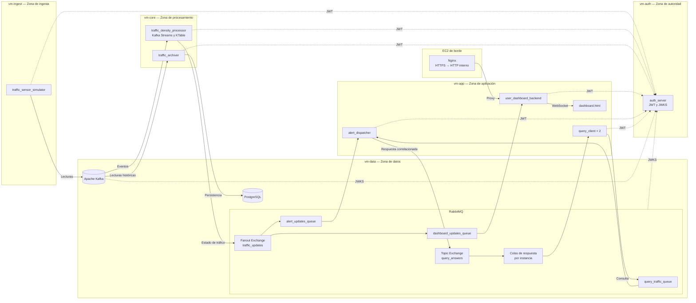

# SmartTraffic — Zona Cero (Zero Trust)

Proyecto 12 — Sistemas Distribuidos, Sistemas Operativos y Programación Orientada a Objetos.

SmartTraffic simula lecturas de sensores de tráfico urbano, calcula el estado de congestión por zona, distribuye actualizaciones en tiempo real, responde consultas asíncronas y conserva un histórico inmutable. El sistema se despliega en cinco máquinas virtuales aisladas en AWS con una arquitectura Zero Trust: cada componente se autentica con un token JWT antes de comunicarse, y las reglas de red bloquean todo tráfico no autorizado por defecto.

La demo está disponible en **[https://3.148.199.141/login](https://3.148.199.141/login)**.

---

## Equipo

| Integrante | Responsabilidad principal |
|---|---|
| Sebastián Orlando Manchabajoy | Coordinación, dominio Java, POO y persistencia |
| Héctor Alejandro Riascos | Infraestructura, Ansible, VMs, Docker y `nftables` |
| Steven Eraso Insuasti | Autenticación, JWT/JWKS, seguridad de Kafka y RabbitMQ |

---

## Índice

1. [Contexto y problema](#contexto-y-problema)
2. [Arquitectura](#arquitectura)
3. [Decisiones de diseño](#decisiones-de-diseño)
4. [Microservicios](#microservicios)
5. [Flujo de datos](#flujo-de-datos)
6. [Seguridad Zero Trust](#seguridad-zero-trust)
7. [Diseño orientado a objetos](#diseño-orientado-a-objetos)
8. [Persistencia y auditoría](#persistencia-y-auditoría)
9. [Infraestructura y contenedores](#infraestructura-y-contenedores)
10. [Pruebas](#pruebas)
11. [Evidencia de despliegue](#evidencia-de-despliegue)
12. [Cómo ejecutar las pruebas localmente](#cómo-ejecutar-las-pruebas-localmente)
13. [Tecnologías utilizadas](#tecnologías-utilizadas)

---

## Contexto y problema

Una ciudad inteligente necesita monitorear el flujo vehicular en tiempo real. Los sensores distribuidos generan lecturas continuas que deben procesarse, almacenarse y distribuirse a múltiples consumidores con distintas responsabilidades: un dashboard visual, un sistema de alertas y clientes de consulta.

El reto del Proyecto 12 agrega una restricción de infraestructura: el sistema debe operar en un entorno de red hostil donde ningún componente confía en otro por defecto. Cada servicio debe demostrar su identidad antes de publicar o consumir mensajes, y las reglas de red deben bloquear todo tráfico no explícitamente permitido.

---

## Arquitectura

El sistema se distribuye en cinco zonas de seguridad, cada una en una VM independiente en AWS:

| VM | Componentes | Responsabilidad |
|---|---|---|
| `vm-auth` | `auth_server` | Emitir tokens JWT firmados con RS256 y publicar claves públicas mediante JWKS |
| `vm-data` | Kafka, RabbitMQ, PostgreSQL | Proveer mensajería y almacenamiento a los servicios autorizados |
| `vm-ingest` | `traffic_sensor_simulator` | Generar lecturas aleatorias de sensores y publicarlas en Kafka |
| `vm-core` | `traffic_density_processor`, `traffic_archiver` | Calcular el estado de tráfico por zona y persistir lecturas en PostgreSQL |
| `vm-app` | `user_dashboard_backend`, `alert_dispatcher`, `query_client` | Servir el dashboard, gestionar alertas y responder consultas |

Una EC2 de borde adicional (`vm-dashboard-public`) ejecuta Nginx como proxy inverso hacia `vm-app`. No reemplaza ninguna de las cinco VMs del proyecto ni accede directamente a los brokers.

### Diagrama de arquitectura



---

## Decisiones de diseño

### ¿Por qué Kafka y RabbitMQ juntos?

Usamos ambos brokers porque tienen roles distintos y complementarios:

**Kafka** actúa como log de eventos inmutable. Es ideal para la ingesta porque:
- Permite que múltiples consumidores lean el mismo tópico de forma independiente (el procesador y el archivador consumen `traffic_readings` en paralelo sin interferirse)
- Kafka Streams procesa el flujo con estado, agrupando lecturas por zona en ventanas de tiempo para calcular densidades
- Los mensajes persisten en el tópico y pueden ser reprocesados

**RabbitMQ** actúa como bus de distribución de estado. Es ideal para la etapa posterior porque:
- El exchange `fanout` distribuye cada actualización de estado a múltiples colas simultáneamente (dashboard y alertas) sin que el publicador conozca a los consumidores
- El exchange `topic` enruta respuestas de consulta a la instancia exacta que las solicitó mediante routing keys
- AMQP ofrece confirmaciones de entrega por mensaje (`basicAck`/`basicNack`)

La interoperabilidad ocurre en el procesador: consume de Kafka y publica en RabbitMQ. Kafka no es un broker AMQP ni se conecta automáticamente a RabbitMQ.

### ¿Por qué un Auth Server propio?

El enunciado exige autenticación de servicio a servicio. Un Auth Server centralizado con OAuth2 Client Credentials permite:
- Emitir tokens JWT firmados con RS256 con audiencias y scopes específicos por servicio
- Que Kafka y RabbitMQ validen los tokens directamente consultando el endpoint JWKS, sin depender de una base de datos de sesiones
- Revocar o expirar credenciales sin tocar el código de los microservicios

### ¿Por qué un Compose canónico con perfiles en lugar de uno por VM?

El enunciado pide orquestación con Docker Compose. Mantener un archivo por VM duplicaba definiciones y dificultaba el mantenimiento. El archivo `infra/compose.yaml` define cada servicio una sola vez y usa perfiles para activar solo los servicios de cada VM:

```
docker compose --profile auth   up -d   # vm-auth
docker compose --profile data   up -d   # vm-data
docker compose --profile ingest up -d   # vm-ingest
docker compose --profile core   up -d   # vm-core
docker compose --profile app    up -d   # vm-app
```

Ansible pasa el perfil correcto a cada VM automáticamente.

---

## Microservicios

### `auth_server` — `vm-auth`

Servidor Spring Authorization Server que emite tokens JWT firmados con RS256. Expone:
- `POST /oauth2/token` — recibe `client_id` y `client_secret`, devuelve un JWT con audiencia y scopes configurados por cliente
- `GET /oauth2/jwks` — publica las claves públicas para que Kafka y RabbitMQ validen los tokens sin llamar al Auth Server en cada operación

Cada cliente de servicio tiene su propia identidad, secret y conjunto de audiencias. Las credenciales no se incluyen en el repositorio.

### `traffic_sensor_simulator` — `vm-ingest`

Genera lecturas aleatorias de sensores con `TrafficReadingGenerator`. El método `generate()` elige un sensor y una zona al azar, genera un conteo de vehículos dentro de un rango configurado y crea un identificador único UUID para la lectura.

Publica cada lectura en Kafka con `KafkaTrafficReadingPublisher`. La zona se usa como clave del `ProducerRecord`, lo que garantiza que todas las lecturas de una misma zona lleguen a la misma partición en orden.

### `traffic_density_processor` — `vm-core`

Consume el tópico `traffic_readings` con Kafka Streams. `TrafficDensityTopology` construye el pipeline:

1. `.stream()` — lee el flujo del tópico
2. `.groupBy(zona)` — agrupa lecturas por zona
3. `.windowedBy()` — divide en ventanas de tiempo configurables
4. `.aggregate()` — acumula vehículos por ventana en un `ZoneWindowAggregate`

El resultado se procesa en `ZoneTrafficAggregate`, que calcula la densidad con la estrategia configurada y transiciona el estado de la zona. Publica el `TrafficUpdate` resultante en RabbitMQ.

### `traffic_archiver` — `vm-core`

Consume el mismo tópico `traffic_readings` con un grupo de consumidores independiente (`traffic-archiver`). Persiste cada lectura en PostgreSQL mediante `JpaTrafficReadingArchiveAdapter`. La operación es idempotente: si llega un `event_id` duplicado, no sobrescribe el registro existente.

### `user_dashboard_backend` — `vm-app`

Consume la cola `dashboard_updates_queue` de RabbitMQ con confirmación manual (`basicAck`/`basicNack`). Transmite cada actualización al navegador por WebSocket en `/ws/traffic`. El backend escucha en `0.0.0.0:8080`; el Security Group y `nftables` restringen el acceso a la EC2 de borde.

### `alert_dispatcher` — `vm-app`

Mantiene una réplica local del estado por zona en `TrafficStateStore`. Cuando detecta una transición de estado (por ejemplo, `DESPEJADA → CONGESTIONADA`), genera un `TrafficAlert` y lo registra. También atiende consultas del `query_client`: lee el estado actual de su réplica y publica la respuesta en el exchange `query_answers` con la routing key de la instancia solicitante.

### `query_client` — `vm-app`

Publica consultas periódicas sobre zonas configuradas en `query_traffic_queue`. Cada consulta incluye `requestId`, `correlationId` y `replyTo` apuntando a su cola exclusiva. Al recibir la respuesta, verifica que el `correlationId` coincida con el `requestId` de la solicitud. Se despliegan dos instancias fijas, cada una con su propia identidad OAuth y cola de respuesta.

---

## Flujo de datos

```
1. traffic_sensor_simulator
   → genera TrafficReading aleatorio (sensor, zona, vehículos, hora, UUID)
   → publica en Kafka: tópico traffic_readings, clave = zona

2. Kafka (vm-data)
   → valida token SASL/OAUTHBEARER
   → distribuye a partición según clave de zona

3. traffic_density_processor (vm-core)
   → consume traffic_readings con Kafka Streams
   → agrupa por zona, agrega en ventanas, calcula densidad
   → transiciona estado: DESPEJADA / MODERADA / CONGESTIONADA
   → publica TrafficUpdate en RabbitMQ exchange traffic_updates

   traffic_archiver (vm-core) — en paralelo
   → consume traffic_readings con grupo independiente
   → persiste en PostgreSQL con trigger de auditoría

4. RabbitMQ fanout exchange traffic_updates (vm-data)
   → entrega a dashboard_updates_queue → user_dashboard_backend
   → entrega a alert_updates_queue → alert_dispatcher

5. user_dashboard_backend (vm-app)
   → confirma mensaje con basicAck
   → envía TrafficUpdate por WebSocket al navegador

6. alert_dispatcher (vm-app)
   → actualiza réplica local
   → registra alerta si hay transición de estado

7. query_client (vm-app)
   → publica consulta en query_traffic_queue
   → alert_dispatcher responde desde réplica local
   → respuesta llega por cola exclusiva con correlationId verificado
```

---

## Seguridad Zero Trust

### Principio

Ningún servicio confía en otro por defecto. Cada conexión debe presentar un token JWT válido. Las reglas de red bloquean todo tráfico no autorizado antes de que llegue a los servicios.

### Autenticación de servicio a servicio

Todos los microservicios obtienen un token del Auth Server antes de conectarse a Kafka o RabbitMQ:

- **Kafka:** `SASL_SSL/OAUTHBEARER`. El broker valida el token consultando el endpoint JWKS del Auth Server.
- **RabbitMQ:** plugin `rabbitmq_auth_backend_oauth2`. El broker valida el token y verifica los scopes antes de permitir publicaciones o consumos.
- **TLS:** Kafka negocia TLS 1.3. RabbitMQ usa `amqp/ssl`. Los clientes validan el certificado del broker con sus truststores.

### Reglas de red (`nftables`)

Cada VM aplica política `DROP` por defecto. Solo se permite el tráfico explícitamente declarado:

| VM | Entrada permitida | Salida permitida |
|---|---|---|
| `vm-auth` | TCP 443 desde `vm-ingest`, `vm-core`, `vm-app`, `vm-data` | — |
| `vm-data` | TCP 9092 desde `vm-ingest` y `vm-core`; TCP 5672 desde `vm-core` y `vm-app`; TCP 5432 desde `vm-core` | TCP 443 hacia `vm-auth` |
| `vm-ingest` | — | TCP 9092 hacia `vm-data`; TCP 443 hacia `vm-auth` |
| `vm-core` | — | TCP 9092, 5672, 5432 hacia `vm-data`; TCP 443 hacia `vm-auth` |
| `vm-app` | — | TCP 5672 hacia `vm-data`; TCP 443 hacia `vm-auth` |

La plantilla está en `infra/deployment/ansible/templates/smarttraffic.nft.j2`. Ansible la aplica con las IPs privadas reales de cada VM durante el despliegue.

### Acceso público al dashboard

El dashboard se publica en `https://3.148.199.141/login`. Nginx en la EC2 de borde termina TLS y reenvía por HTTP al backend privado de `vm-app`. El puerto 8080 de `vm-app` solo acepta conexiones desde la IP privada de la EC2 de borde. El flujo de login usa Spring Security con OAuth2; las credenciales se verifican contra una cuenta en PostgreSQL.

---

## Diseño orientado a objetos

### Strategy — cálculo de densidad

`DensityCalculationStrategy` es una interfaz con dos implementaciones intercambiables:

- `AverageDensityStrategy` — promedio simple de vehículos por lectura en la ventana
- `TimeWeightedDensityStrategy` — promedio ponderado que da más peso a las lecturas más recientes

El procesador elige la estrategia por variable de entorno (`TRAFFIC_DENSITY_STRATEGY`). El `ZoneTrafficAggregate` llama a `strategy.calculateWindow()` sin saber cuál implementación usa.

### State — transiciones de zona

`TrafficState` es una interfaz implementada por `ClearTrafficState`, `ModerateTrafficState` y `CongestedTrafficState`. Cada estado encapsula sus umbrales y decide la transición siguiente. `ZoneTrafficStateMachine` delega en el estado actual sin usar `if-else` ni `switch`.

### Observer — eventos de dominio

`TrafficEventObserver` es una interfaz que recibe eventos cuando ocurren transiciones de estado o se alcanza densidad crítica. `TrafficEventLoggingObserver` es la implementación actual. El agregado notifica a todos los observadores registrados sin acoplar la lógica de dominio a la infraestructura.

### DIP — inversión de dependencias

Los casos de uso dependen de interfaces de puerto, no de implementaciones concretas:

- `ArchiveTrafficReadingUseCase` depende de `TrafficReadingArchivePort`
- `JpaTrafficReadingArchiveAdapter` implementa ese puerto con Spring Data JPA
- `TrafficUpdatePublisher` abstrae la publicación en RabbitMQ

### Value Objects e inmutabilidad

Los contratos compartidos son `record` de Java: `TrafficReading`, `TrafficUpdate`, `ZoneId`, `SensorId`, `TrafficAlert`. Cada uno valida sus invariantes en el constructor compacto y falla rápido ante valores inválidos (nulos, negativos, vacíos). Una vez creados no se pueden modificar.

### Modelo de dominio rico

`ZoneTrafficAggregate` no es un contenedor de datos: encapsula el estado de la zona, valida las lecturas entrantes, calcula densidad usando la estrategia inyectada, transiciona el estado mediante la máquina de estados y notifica eventos. No expone setters.

---

## Persistencia y auditoría

PostgreSQL almacena el histórico de lecturas mediante Spring Data JPA / Hibernate. Flyway gestiona las migraciones del esquema.

### Migración V1 — esquema base

Crea la tabla `traffic_readings` con restricciones de integridad: `event_id` como clave primaria no vacía, conteo de vehículos no negativo.

### Migración V2 — auditoría e inmutabilidad

Agrega la tabla `traffic_reading_audit` y cuatro triggers:

- **`trg_traffic_readings_audit_insert`** — después de cada INSERT en `traffic_readings`, registra automáticamente la operación en `traffic_reading_audit` con la hora exacta
- **`trg_traffic_readings_reject_mutation`** — rechaza cualquier UPDATE o DELETE sobre `traffic_readings` con error `Table traffic_readings is append-only`
- **`trg_traffic_readings_reject_truncate`** — rechaza TRUNCATE sobre `traffic_readings`
- **`trg_traffic_reading_audit_reject_mutation`** y `trg_traffic_reading_audit_reject_truncate` — protegen también la tabla de auditoría

Esto garantiza que bajo operación normal nadie puede modificar ni borrar el histórico. Un administrador con acceso privilegiado podría deshabilitar los triggers, por lo que no se afirma inmutabilidad absoluta frente al propietario de la base.

**Estado en AWS:** Flyway aplicó la migración V2 correctamente. La base `smarttraffic` muestra versión 2, descripción `audit_and_protect_traffic_readings` y estado `success = true`.

---

## Infraestructura y contenedores

### Dockerfile multietapa

El archivo `infra/images/app.Dockerfile` tiene dos etapas:

- **Compilación:** imagen Maven + JDK. Descarga dependencias en una capa separada para aprovechar la caché de Docker. Compila el módulo indicado por `MAVEN_MODULE`.
- **Ejecución:** imagen `eclipse-temurin:17-jre-alpine` sin compiladores ni código fuente. Copia solo el JAR compilado. Ejecuta con el usuario no privilegiado `appuser:appgroup`.

Flags JVM configurados en todos los contenedores:
```
-XX:+UseContainerSupport
-XX:MaxRAMPercentage=75.0
-XX:+ExitOnOutOfMemoryError
```

### Límites de recursos por contenedor

| Contenedor | CPU | Memoria |
|---|---|---|
| Auth Server | 0.5 | 768 MiB |
| Kafka | 1.0 | 3 GiB |
| RabbitMQ | 0.5 | 1 GiB |
| PostgreSQL | 0.25 | 1 GiB |
| Simulador | 0.5 | 768 MiB |
| Procesador | 1.0 | 1.5 GiB |
| Archivador | 0.5 | 1 GiB |
| Dashboard backend | 0.5 | 768 MiB |
| Alert dispatcher | 0.5 | 768 MiB |
| Query client (×2) | 0.25 c/u | 384 MiB c/u |

Límites verificados con `docker inspect` en los 11 contenedores corriendo en AWS.

### Orquestación con Compose canónico

`infra/compose.yaml` define los 10 servicios una sola vez con perfiles. Ansible copia el archivo a cada VM y activa el perfil correspondiente. Los Compose de prueba (`infra/vm-data/postgres-it/compose.yaml`, `infra/vm-data/rabbitmq/compose.yaml`) se mantienen separados porque son fixtures de integración, no de despliegue.

### Aprovisionamiento con Ansible

`infra/deployment/ansible/site.yml` automatiza el despliegue completo en orden:

1. Valida los inputs y los volúmenes EBS
2. Instala Docker, nftables y rsync
3. Aplica las reglas de firewall
4. Monta los volúmenes de datos
5. Detecta proyectos Compose legacy y falla si alguno sigue corriendo
6. Copia el código fuente sin secretos ni certificados
7. Construye las imágenes Java con Docker Buildx
8. Instala los archivos de entorno y certificados
9. Valida la configuración Compose
10. Inicia los servicios en orden: Auth → Data → Core/App → Ingest

---

## Pruebas

### Pruebas unitarias

JUnit 5 y Mockito. Todas las pruebas de dominio corren en memoria sin Spring Boot, sin contenedores y sin red. Patrón AAA (Arrange, Act, Assert).

Ejemplos representativos:
- `ZoneTrafficStateMachineTest` — verifica transiciones de estado sin infraestructura
- `TrafficDensityCalculatorTest` — verifica las estrategias de densidad con datos controlados
- `ZoneTrafficAggregateTest` — verifica el comportamiento del agregado ante lecturas válidas e inválidas
- `RabbitMqTrafficUpdateConsumerTest` — verifica `basicAck` y `basicNack` con mocks de Mockito

### Pruebas de integración PostgreSQL

Levantan un contenedor PostgreSQL desechable, aplican las migraciones V1 y V2 con Flyway y verifican:
- Que una lectura insertada aparece en `traffic_reading_audit`
- Que un `event_id` duplicado no sobrescribe el registro ni duplica la auditoría
- Que un UPDATE sobre `traffic_readings` lanza la excepción del trigger
- Que un DELETE sobre `traffic_readings` lanza la excepción del trigger

Resultado verificado localmente: **2 tests, 0 fallos, 0 errores**.

### Resultado global

`mvn -B test` desde la raíz termina con `BUILD SUCCESS`, cero fallos y cero errores. Se omiten cinco casos que requieren servicios externos (Kafka, RabbitMQ en AWS).

---

## Evidencia de despliegue

| Verificación | Resultado |
|---|---|
| Dashboard accesible por HTTPS | `https://3.148.199.141/login` responde 200; HTTP redirige 301 a HTTPS |
| Dashboard en vivo | Actualizaciones de `zone-01` y `zone-02` recibidas por WebSocket |
| Query clients | Dos instancias recibieron respuestas correlacionadas para dos zonas |
| Alert dispatcher | Registró transiciones entre `DESPEJADA`, `MODERADA` y `CONGESTIONADA` |
| PostgreSQL | 39.930 lecturas en `traffic_readings`; última lectura `2026-11-17 14:22:43 UTC` |
| Flyway V2 | Versión 2 aplicada en AWS: `audit_and_protect_traffic_readings` — `success = true` |
| Límites de contenedor | `docker inspect` confirmó CPU y RAM en los 11 contenedores |
| nftables | Política `drop` por defecto en las cinco VMs confirmada en AWS |
| TLS Kafka | Negoció TLS 1.3 en `vm-data` |
| RabbitMQ TLS | Reportó `amqp/ssl` en `vm-data` |

---

## Cómo ejecutar las pruebas localmente

### Requisitos

- Java 17 o superior
- Maven 3.9 o superior
- Docker

### Pruebas unitarias

```powershell
mvn -B test
```

### Pruebas de integración PostgreSQL

```powershell
# Levantar el fixture
docker compose --env-file infra/vm-data/postgres-it/.env `
  -f infra/vm-data/postgres-it/compose.yaml up -d --wait

# Correr las pruebas
$env:TRAFFIC_ARCHIVER_PG_IT = "true"
$env:SPRING_DATASOURCE_URL = "jdbc:postgresql://localhost:5433/smarttraffic"
$env:SPRING_DATASOURCE_USERNAME = "smarttraffic_it"
$env:SPRING_DATASOURCE_PASSWORD = "<contraseña del .env local>"
mvn -B -pl services/traffic-archiver -am test

# Apagar el fixture
docker compose -f infra/vm-data/postgres-it/compose.yaml down
```

### Validar perfiles Compose

```powershell
# Desde infra/
docker compose --env-file .env.validation.example -f compose.yaml --profile auth    config --quiet
docker compose --env-file .env.validation.example -f compose.yaml --profile data    config --quiet
docker compose --env-file .env.validation.example -f compose.yaml --profile ingest  config --quiet
docker compose --env-file .env.validation.example -f compose.yaml --profile core    config --quiet
docker compose --env-file .env.validation.example -f compose.yaml --profile app     config --quiet
docker compose --env-file .env.validation.example -f compose.yaml --profile dashboard config --quiet
docker compose --env-file .env.validation.example -f compose.yaml --profile postgres config --quiet
```

---

## Tecnologías utilizadas

| Categoría | Tecnologías |
|---|---|
| Lenguaje y framework | Java 17, Spring Boot, Spring Authorization Server, Spring Data JPA |
| Mensajería | Apache Kafka, Kafka Streams, RabbitMQ |
| Persistencia | PostgreSQL, Hibernate, Flyway |
| Seguridad | JWT, RS256, JWKS, OAuth2, SASL/OAUTHBEARER, TLS 1.3 |
| Infraestructura | Docker, Docker Compose, Ansible, AWS EC2, nftables |
| Pruebas | JUnit 5, Mockito |
| Build | Maven, Dockerfile multietapa |
