# Arquitectura de SmartTraffic – Zona Cero (Zero Trust)

## Alcance y estado

SmartTraffic propone simular lecturas aleatorias de sensores de tráfico,
calcular el estado de cada zona, distribuir actualizaciones y alertas, responder
consultas y conservar un histórico. La descripción de este documento está
alineada con el [README](../README.md) vigente en `develop`.

El Proyecto 12 exige una arquitectura distribuida con cinco VMs, siete
microservicios, Apache Kafka y Kafka Streams, RabbitMQ, autenticación,
`nftables`, POO, PostgreSQL, pruebas y control de recursos, además de la
generación aleatoria de datos y la orquestación con Docker Compose. La
distribución exacta de servicios entre zonas y los detalles de configuración
descritos aquí son diseño del equipo, no una afirmación de que ya estén
implementados.

## Cinco zonas de despliegue

| VM / zona | Componentes asignados en el diseño | Responsabilidad |
|---|---|---|
| `vm-auth` — autoridad | `auth_server` | Proveer autenticación. La emisión de JWT y la publicación de claves mediante JWKS son propuestas de diseño. |
| `vm-data` — datos | Apache Kafka, RabbitMQ y PostgreSQL, en contenedores independientes | Alojar mensajería y persistencia; limitar el acceso a los servicios autorizados. |
| `vm-ingest` — ingesta | `traffic_sensor_simulator` | Generar lecturas aleatorias de sensores y publicarlas en Kafka. |
| `vm-core` — procesamiento | `traffic_density_processor`, `traffic_archiver` | Calcular el estado de tráfico por zona, publicar actualizaciones y guardar lecturas originales en PostgreSQL. |
| `vm-app` — aplicación | `user_dashboard_backend`, `alert_dispatcher`, `query_client` y `dashboard.html` | Servir el dashboard en tiempo real, gestionar alertas y responder consultas. `dashboard.html` es la interfaz web, no un microservicio. |

El requisito de Docker Compose aplica a la orquestación del proyecto. El equipo
propone desplegar por zona, sin una única red Docker plana que conecte
indiscriminadamente todas las VMs. La topología de redes y el alcance exacto
de Compose entre VMs siguen pendientes de validación.

## Responsabilidades de los servicios

- **`auth_server`:** proveer la autenticación requerida para los servicios. El
  diseño propone emitir JWT y publicar claves públicas mediante JWKS; el
  algoritmo de firma, el endpoint y los detalles del protocolo deben
  confirmarse. Si se utiliza firma asimétrica, la clave privada debe permanecer
  protegida en la autoridad.
- **`traffic_sensor_simulator`:** generar lecturas aleatorias identificadas
  por sensor y zona, validarlas y enviarlas a Kafka.
- **`traffic_density_processor`:** consumir lecturas de Kafka, procesarlas con
  Kafka Streams, mantener estado por zona mediante una KTable, calcular
  densidad y estado, y publicar actualizaciones en RabbitMQ.
- **`traffic_archiver`:** consumir en paralelo las lecturas originales de
  Kafka y persistirlas en PostgreSQL. No depende de RabbitMQ ni del dashboard.
- **`user_dashboard_backend`:** consumir actualizaciones de RabbitMQ y enviarlas
  al navegador mediante WebSocket.
- **`alert_dispatcher`:** consumir actualizaciones, mantener una réplica local
  del estado por zona, detectar cambios de interés y procesar consultas a
  partir de esa réplica.
- **`query_client`:** simular consultas, asignar identificadores de correlación
  y recibir las respuestas destinadas a cada instancia.
- **`dashboard.html`:** mostrar en tiempo real los datos recibidos por el
  backend del dashboard.

## Flujos de mensajes

### Ingesta, procesamiento y distribución

1. `traffic_sensor_simulator` genera lecturas aleatorias y las publica en un
   tópico de Kafka. El nombre definitivo del tópico queda por aprobar; el
   README propone `traffic_readings`.
2. `traffic_density_processor` consume las lecturas mediante Kafka Streams y
   mantiene una KTable por zona. Los detalles de claves, agregaciones y
   ventanas quedan para el diseño detallado.
3. El procesador publica estados consolidados en el fanout exchange RabbitMQ
   `traffic_updates`.
4. El exchange distribuye cada actualización a colas independientes para el
   dashboard y alertas. El README muestra `dashboard_updates_queue` y
   `alert_updates_queue` como propuestas pendientes de aprobación.
5. `user_dashboard_backend` consume la cola del dashboard y transmite los
   datos a `dashboard.html` por WebSocket. `alert_dispatcher` consume la cola
   de alertas, actualiza su réplica local y evalúa las alertas.

### Persistencia histórica

En paralelo al procesamiento, `traffic_archiver` consume las lecturas originales
de Kafka con un grupo de consumidores independiente, las valida y las guarda
en PostgreSQL. La conservación, el esquema y la protección del histórico
requieren decisiones de diseño y pruebas.

### Consultas y respuestas correlacionadas

1. Cada instancia de `query_client` publica una solicitud en la Work Queue
   `query_traffic_queue` con `correlationId` y el destino de respuesta en
   `replyTo`.
2. `alert_dispatcher` consume la solicitud y obtiene el estado solicitado de
   su réplica local; no consulta PostgreSQL directamente.
3. El dispatcher publica la respuesta en el Topic Exchange `query_answers`,
   conservando el `correlationId` y usando una routing key asociada a la
   instancia solicitante.
4. Cada instancia de `query_client` recibe respuestas en su propia cola. Se
   requieren colas de respuesta independientes, un identificador de instancia
   y manejo de espera y fallos; el nombre y binding exactos quedan por definir.

## Identidad y seguridad entre servicios

La autenticación es un requisito del Proyecto 12. El equipo propone identidades
separadas para cada servicio y autenticación de servicio a servicio mediante
tokens. JWT, RS256, JWKS, claims, audiencias, scopes y renovación son detalles
del diseño que deben confirmarse contra el enunciado completo y aprobarse; no
se deben presentar como requisitos explícitos si el enunciado no los especifica.
La clave privada, si se adopta firma asimétrica, no debe copiarse a otros
servicios.

El requisito es autenticar las comunicaciones; SASL/OAUTHBEARER, ACL y el
plugin OAuth2 de RabbitMQ son mecanismos propuestos. Los permisos sobre topics,
exchanges y colas deben ser de mínimo privilegio. Para PostgreSQL se propone
una identidad de base de datos limitada para `traffic_archiver`; los tokens de
los brokers no sustituyen la autenticación de PostgreSQL.

TLS y la aplicación efectiva de permisos se deben configurar y comprobar. La
presencia de estos mecanismos en el diseño no significa que estén
implementados. No deben guardarse claves privadas, tokens ni credenciales
reales en Git.

## Segmentación, Docker y recursos

El Proyecto 12 requiere `nftables`. La política de denegación por defecto y
permitir solo flujos autorizados es la propuesta del equipo, no una regla
numérica ya aprobada. Las reglas definitivas dependen de la matriz de
comunicaciones y de la validación del tráfico que atraviese las redes Docker. La
[matriz de comunicaciones](./network-matrix.md) registra los flujos conocidos
y deja sin especificar los puertos no acordados.

Docker Compose es requisito del proyecto. Se propone usarlo para desplegar y
reproducir los componentes por VM, sin reemplazar la segmentación entre VMs ni
la autorización. El control de recursos es requisito; los límites concretos de
CPU y memoria y su distribución por contenedor deben medirse y validarse. La
ejecución sin privilegios es una propuesta de endurecimiento. Declarar límites
en archivos no prueba que se apliquen.

Vagrant y/o Ansible se evaluarán para aprovisionar las máquinas y configurarlas.
Vagrant para crear VMs y Ansible para configurarlas es una propuesta, no una
decisión aprobada. La disponibilidad del hipervisor y la capacidad del equipo
deben comprobarse antes de instalar o desplegar.

## Diagrama lógico

El diagrama refleja la arquitectura propuesta y los nombres que aparecen en el
README. No especifica direcciones IP, puertos ni una topología de red
definitiva.

```mermaid
flowchart LR
    subgraph AUTH["vm-auth - autoridad"]
        AS["auth_server<br/>autenticación y emisión de tokens<br/>algoritmo / endpoint pendientes"]
    end

    subgraph INGEST["vm-ingest - ingesta"]
        SIM["traffic_sensor_simulator"]
    end

    subgraph CORE["vm-core - procesamiento"]
        PROC["traffic_density_processor<br/>Kafka Streams / KTable"]
        ARCH["traffic_archiver"]
    end

    subgraph DATA["vm-data - datos"]
        KAFKA["Apache Kafka"]
        subgraph RMQ["RabbitMQ"]
            UPDATES["Fanout Exchange<br/>traffic_updates"]
            DASHQ["dashboard_updates_queue<br/>(propuesta)"]
            ALERTQ["alert_updates_queue<br/>(propuesta)"]
            QUERYQ["Work Queue<br/>query_traffic_queue"]
            ANSWERS["Topic Exchange<br/>query_answers"]
            REPLYQ["Colas de respuesta<br/>una por instancia"]
        end
        PG["PostgreSQL"]
    end

    subgraph APP["vm-app - aplicación"]
        DASH["user_dashboard_backend"]
        ALERT["alert_dispatcher<br/>réplica local de estados"]
        QUERY["query_client<br/>una cola de respuesta por instancia"]
        WEB["dashboard.html"]
    end

    SIM -->|"lecturas aleatorias"| KAFKA
    KAFKA -->|"lecturas para procesamiento"| PROC
    KAFKA -->|"lecturas originales"| ARCH
    ARCH -->|"persistencia histórica"| PG
    PROC -->|"estados por zona"| UPDATES
    UPDATES --> DASHQ
    UPDATES --> ALERTQ
    DASHQ --> DASH
    ALERTQ --> ALERT
    DASH -->|"WebSocket"| WEB
    QUERY -->|"solicitud: replyTo + correlationId"| QUERYQ
    QUERYQ -->|"solicitud"| ALERT
    ALERT -->|"respuesta correlacionada"| ANSWERS
    ANSWERS --> REPLYQ
    REPLYQ -->|"respuesta a la instancia solicitante"| QUERY

    SIM -. "solicitud de token" .-> AS
    AS -. "JWT firmado (mecanismo pendiente)" .-> SIM
    PROC -. "solicitud de token" .-> AS
    AS -. "JWT firmado (mecanismo pendiente)" .-> PROC
    ARCH -. "solicitud de token" .-> AS
    AS -. "JWT firmado (mecanismo pendiente)" .-> ARCH
    DASH -. "solicitud de token" .-> AS
    AS -. "JWT firmado (mecanismo pendiente)" .-> DASH
    ALERT -. "solicitud de token" .-> AS
    AS -. "JWT firmado (mecanismo pendiente)" .-> ALERT
    QUERY -. "solicitud de token" .-> AS
    AS -. "JWT firmado (mecanismo pendiente)" .-> QUERY
    KAFKA -. "obtiene claves públicas JWKS" .-> AS
    RMQ -. "obtiene claves públicas JWKS" .-> AS
```

## Requisitos, propuestas y decisiones pendientes

### Requisitos explícitos del Proyecto 12

- Arquitectura con cinco máquinas virtuales y siete microservicios.
- Apache Kafka y Kafka Streams para la mensajería y el procesamiento de
  eventos.
- RabbitMQ para distribución de mensajes.
- Autenticación de los componentes.
- `nftables` para la configuración de firewall.
- Programación Orientada a Objetos.
- PostgreSQL para persistencia.
- Pruebas.
- Control de recursos.
- Generación aleatoria de datos y orquestación con Docker Compose.
- Entrega del repositorio y demostración funcional, explicando arquitectura y
  decisiones de diseño.

### Propuestas del diseño del equipo

- Asignar los componentes a zonas como se muestra en la tabla anterior.
- Implementar los microservicios con Java/Spring Boot y la interfaz
  `dashboard.html`.
- Usar una KTable por zona para calcular el estado del tráfico.
- Distribuir actualizaciones con el fanout `traffic_updates` y las colas
  propuestas.
- Responder consultas con `alert_dispatcher`, una réplica local y respuestas
  correlacionadas por instancia.
- Usar JWT, RS256/JWKS, SASL/OAUTHBEARER y ACL en Kafka, OAuth2 en RabbitMQ,
  credenciales específicas en PostgreSQL, TLS y política de denegación por
  defecto en `nftables`.
- Evaluar Vagrant y/o Ansible y aplicar límites de recursos por contenedor.

Estas propuestas se mantienen sujetas a aprobación y validación del equipo.

### Decisiones pendientes

- Aprobar nombres y contratos de topics, mensajes, colas, bindings y routing
  keys, incluidos los nombres de las colas de respuesta por instancia.
- Definir algoritmo, claves, agregaciones, ventanas y umbrales de densidad.
- Precisar credenciales de servicio, claims, audiencias, scopes, expiración,
  renovación y permisos de JWT, así como confirmar si RS256, JWKS y el endpoint
  de tokens son requisitos o elecciones del equipo.
- Determinar configuración TLS y listeners seguros para Kafka, RabbitMQ,
  PostgreSQL, autenticación, JWKS y dashboard.
- Acordar direcciones, puertos y sentidos concretos de la matriz de red antes
  de escribir reglas definitivas; decidir también si son necesarios los flujos
  condicionales de DNS, NTP, SSH de administración o Internet para
  aprovisionamiento.
- Definir esquema, auditoría, retención, copias de seguridad e integridad del
  histórico.
- Elegir proveedor de virtualización y confirmar compatibilidad con Vagrant,
  Ansible y los recursos disponibles.
- Medir y acordar límites de CPU y memoria, número de réplicas, monitoreo,
  registros, reintentos, idempotencia y recuperación.

## Riesgos técnicos iniciales

- Cinco VMs y varios brokers o servicios pueden superar los recursos del host.
- Una política de firewall incompleta puede bloquear flujos válidos o permitir
  accesos excesivos, especialmente a través de redes Docker.
- La exposición de secretos o de la clave privada RS256 comprometería la
  identidad de los servicios.
- Sin decisiones de entrega, reintentos e idempotencia pueden producirse
  mensajes perdidos o duplicados.
- El procesamiento y la persistencia paralelos pueden observar o conservar
  eventos en momentos distintos.
- Réplicas locales múltiples de `alert_dispatcher` requieren consistencia para
  responder consultas correctamente.
- La falta de monitoreo y registros correlacionados entre zonas complica la
  integración y el diagnóstico.

## Estado

Este documento describe el diseño inicial propuesto. No confirma que se hayan
creado o probado VMs, contenedores, servicios, reglas de firewall ni
automatizaciones.
